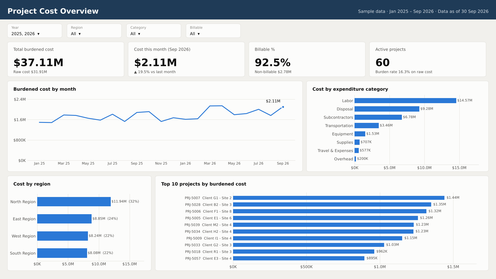

# Power BI Work

Two pieces of Power BI work: a dashboard I built, and a troubleshooting case study for a dashboard I took over.

## 1. Project Cost Dashboard → [`project-cost-dashboard/`](project-cost-dashboard/)

A two-page Power BI report (overview and project detail) on a star schema, with time-intelligence DAX, billable analysis and project ranking. It runs on sample data or on the Gold layer of my [Fabric pipeline](https://github.com/wajahat717/microsoft-fabric-medallion-pipeline).

## 2. Troubleshooting an inherited dashboard → [`troubleshooting-case-study/`](troubleshooting-case-study/)

Six problems users reported on a half-finished target-hours dashboard, covering refresh failures, Dataflow access, Power Automate, business rules, missing columns and data mismatches. For each one: the real cause, and the fix.

## Skills shown

Data modelling (star schema) · DAX (time intelligence, ranking, share) · Power Query (M) · Power BI Service (refresh, Dataflows, workspace access) · SharePoint and Power Automate sources · Microsoft Fabric as the source

> All data shown is made up. No client names or real numbers are included.
