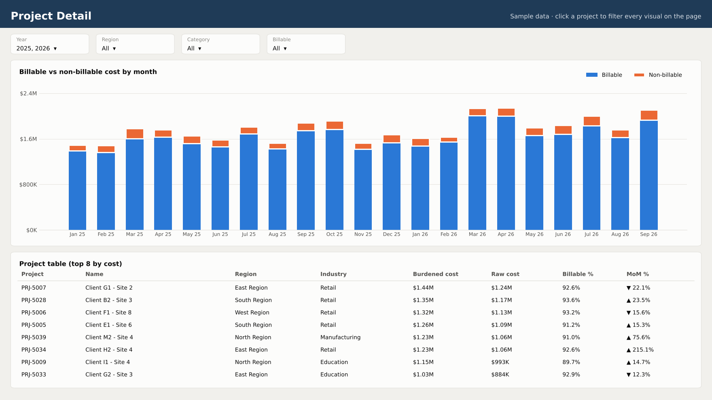

# Project Cost Dashboard (Power BI)

A two-page Power BI report that shows project cost by month, category, region and project. It is built on the Gold star schema from my [Fabric medallion pipeline](https://github.com/wajahat717/microsoft-fabric-medallion-pipeline).

> **All data here is made up.** `scripts/generate_sample_data.py` creates it, with the same table shapes as the real Gold layer, so anyone can open and explore the report.

## Page 1: Overview


- **KPI cards:** total burdened cost, this month's cost with change vs last month, billable %, and active projects
- **Monthly trend** of burdened cost
- **Cost by category** and **cost by region** (with share %)
- **Top 10 projects** by cost

## Page 2: Project detail



- **Billable vs non-billable** cost by month
- **Project table** with burdened cost, raw cost, billable % and month-over-month change

Both pages share the same slicers (Year, Region, Category, Billable), and clicking any bar filters the whole page.

## Data model (star schema)

```
              dim_date
             (date_key)
                 │
dim_organization │      dim_expenditure_type
(organization_key)│      (expenditure_type_key)
          \       │       /
           ▼      ▼      ▼
          fact_project_cost
           (one row per cost line)
                  ▲
                  │
             dim_project
            (project_key)
```

- All relationships are **many-to-one, single direction**, from dimension to fact.
- `dim_date` is marked as the **date table**, so time intelligence (MTD, YTD, previous month, same period last year) works.
- Every dimension has an **Unknown (-1)** row, so cost with a missing reference still adds up to the right total.

## Measures

All measures are in [`dax/measures.dax`](dax/measures.dax):

| Group | Measures |
|---|---|
| Base | Burdened Cost, Raw Cost, Burden Amount, Burden %, Cost Lines, Active Projects |
| Billable | Billable Cost, Non-Billable Cost, Billable % |
| Time | Cost MTD, Cost YTD, Cost Previous Month, Cost MoM %, Cost Same Period LY, Cost YoY %, Cost Rolling 3M |
| Ranking | Project Rank, Category Share %, Region Share %, Avg Cost per Project |
| Labels | MoM Arrow, Data As Of |

## How to build it in Power BI Desktop (about 15 minutes)

1. Run `python scripts/generate_sample_data.py` (or use the CSVs already in `sample-data/`).
2. **Get data → Text/CSV** and load the five files. For the real Fabric Gold layer, use the query in [`power-query/connect_to_fabric_gold.pq`](power-query/connect_to_fabric_gold.pq).
3. In **Model view**, create the relationships shown above, and mark `dim_date` as the date table.
4. Create an empty table named `_Measures` and paste in the measures from `dax/measures.dax`.
5. Build the two pages using the screenshots as the layout guide.

## Folder guide

| Folder | Contents |
|---|---|
| `sample-data/` | Made-up CSVs: dim_date, dim_organization, dim_expenditure_type, dim_project, fact_project_cost (about 27,000 rows) |
| `dax/` | All DAX measures |
| `power-query/` | Power Query M for Fabric (production) and for the CSVs (demo) |
| `scripts/` | Sample data generator and the script that draws the preview screenshots |
| `screenshots/` | Preview of both report pages, drawn from the sample data |

## Tools

Power BI Desktop · DAX · Power Query (M) · Star schema modelling · Microsoft Fabric Warehouse · Python (pandas, matplotlib)
